<div align="center">


<a href="https://github.com/AlishaMeier">
  
</a>

<br/>

<a href="https://www.linkedin.com/in/alisha-meier-qa"></a>


</div>

<div align="center">
  
</div>

<br/>

```bash
alisha@nightcity:~$ whoami
> Alisha. QA engineer. I test APIs, web and backend systems.

alisha@nightcity:~$ cat about.txt
> I care about quality and I notice details others skip.
> I learn fast, I'm a kind teammate, and I'll happily ask "wait, what happens if...?"
> Currently looking at pentesting as the next level of "what happens if...?"

alisha@nightcity:~$ ./status.sh
> 🐈‍⬛ cats: supervising          🎧 music: rock / K-pop
> 🌙 mood: gothic                  💜 colors: black, pink, violet
```

<div align="center"></div>

<div align="center">

## 🕷️ Character Sheet

<table>
  <tr>
    <td align="center" width="200"><b>Class</b><br/>QA Engineer</td>
    <td align="center" width="200"><b>Specialty</b><br/>APIs · Web · Backend</td>
    <td align="center" width="200"><b>Side quest</b><br/>Pentesting 🗡️</td>
  </tr>
  <tr>
    <td align="center"><b>Superpower</b><br/>Finding the bug<br/>nobody planned for</td>
    <td align="center"><b>Weakness</b><br/>Cats on the keyboard</td>
    <td align="center"><b>Party role</b><br/>Fast learner,<br/>good teammate</td>
  </tr>
</table>

</div>

<div align="center"></div>

<div align="center">

## ⚔️ Arsenal


<br/>


<br/>


</div>

<div align="center"></div>

<div align="center">

## 🎓 Training

</div>

- **Bachelor's**, Information Systems & Media Technologies, SSUTI (Novosibirsk)
- **Courses:** manual QA · Selenium with Python · test automation in Python
- **Diploma project:** [diploma_project_spotify](https://github.com/AlishaMeier/diploma_project_spotify) 🎧

<div align="center"></div>

<div align="center">

## 🌑 After Hours

<table>
  <tr>
    <td align="center" width="170">🐈‍⬛<br/><b>Cats</b><br/><sub>the real bosses</sub></td>
    <td align="center" width="170">🎌<br/><b>Anime</b><br/><sub>and K-dramas</sub></td>
    <td align="center" width="170">🌃<br/><b>Cyberpunk</b><br/><sub>neon, rain, chrome</sub></td>
    <td align="center" width="170">🦇<br/><b>Gothic</b><br/><sub>dark and pretty</sub></td>
  </tr>
  <tr>
    <td align="center">🔪<br/><b>Suspense</b><br/><sub>psychological thrillers</sub></td>
    <td align="center">🎮<br/><b>PC games</b><br/><sub>and finding their bugs</sub></td>
    <td align="center">🎸<br/><b>Music</b><br/><sub>rock to K-pop</sub></td>
    <td align="center">🚲<br/><b>Wheels</b><br/><sub>cycling and pit bikes</sub></td>
  </tr>
</table>

</div>

<div align="center"></div>

<div align="center">


<br/>

<i>"Quality means doing it right even when no one is looking."</i><br/>
<sub>— Henry Ford</sub>

</div>
